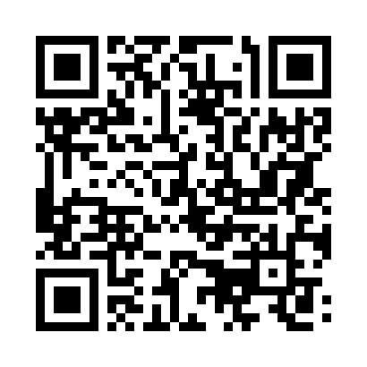

# Retail Sales Dashboard

A small Python project that reads sales from a CSV and creates a dashboard PNG
with Matplotlib. The dashboard includes total revenue, units sold, average
order value, monthly revenue, category revenue, regional revenue share, and
units sold by category.

## Run

```bash
python -m pip install -r requirements.txt
python sales_dashboard.py sales_data.csv
```

The generated `sales_dashboard.png` is saved in the current folder. Use
`python sales_dashboard.py your_data.csv --output report.png` to choose another
CSV or output image.

## CSV columns

The CSV must include `date` (YYYY-MM-DD), `product`, `category`, `quantity`,
`unit_price`, and `region`. A sample dataset is included.

## Project QR Code

Scan to open this GitHub repository:


